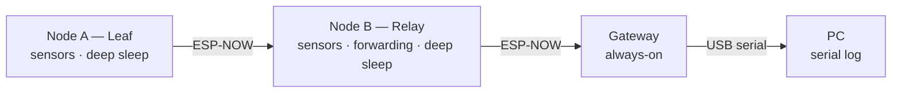
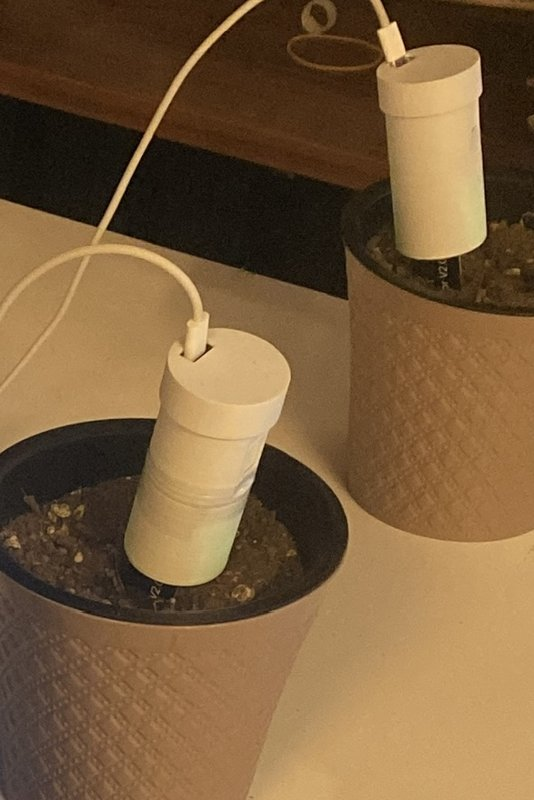

# Energy-Efficient Linear Multi-Hop IoT Network (ESP32-C6 / ESP-NOW)

A low-power sensor chain for precision agriculture: leaf and relay nodes deep-sleep most of the time, wake on a shared schedule, and forward readings hop-by-hop over ESP-NOW to an always-on gateway. Built as an individual research project (TED University, CMPE490 – Introduction to Research in Computer Engineering, Spring 2026).

**Status:** Phase 1 (research prototype) completed June 2026 — indoor, USB-powered. Phase 2 (battery operation, power profiling, field tests) planned. *Last updated: 10.2026*

---

## Problem

Field sensors in agriculture are often out of Wi-Fi range and must eventually run on batteries. A Wi-Fi/MQTT-per-node design keeps the radio on too long. This project explores how far a low-cost ESP32 chain can go using a connectionless protocol (ESP-NOW) plus coordinated sleep, without an external RTC or extra radio hardware.

## Architecture

Three physical devices: two sensor nodes (leaf, relay) and one gateway.



## Key features

| Feature | Approach |
|---|---|
| Time synchronization | Cristian's algorithm + EWMA smoothing (α = 0.2); no external RTC |
| Setup phase | Handshake to align nodes at first power-on |
| Adaptive TX power | RSSI-driven, 11.0–19.5 dBm, ±5 dB hysteresis |
| In-network aggregation | Weighted-average merge implemented (`relay_aggregate()`), **not enabled** in the tested firmware — relay currently forwards the leaf's packet |
| Self-healing | Failure counter persisted in RTC memory across deep sleep; skip-route after 3 failures. Compile-time option, **off by default** (`ENABLE_SELF_HEALING`) |
| Sensor power gating | P-MOSFET switches analog sensors off during sleep |
| FEC | 5 bytes reserved in packet; Hamming(72,64) **not implemented** (Phase 2) |

## Hardware

| Item | Detail |
|---|---|
| MCU | ESP32-C6 Super Mini (RISC-V, 160 MHz) — all three devices |
| Sensors (V2) | DS18B20 (soil temperature), BMP180 (pressure/temperature), SW-520D (tilt) |
| Sensors (V1) | DHT22, capacitive soil moisture |
| Power (Phase 1) | USB-powered during all tests — **no battery yet** |
| Power (Phase 2) | Single-cell lithium battery + voltage-divider monitoring (planned) |
| Gateway link | USB serial, 115200 baud, compact CSV lines (`D:<id>,<soil>,<temp>,...`). Wi-Fi radio runs in STA mode only because ESP-NOW requires it — no Wi-Fi association, no MQTT |

<p align="center">
  
</p>
<p align="center"><em>Phase 1 prototype — two sensor nodes in plant pots, USB-powered, indoor. Gateway not shown.</em></p>

## Results (Phase 1)

All tests: indoor, ~1.5 m node spacing, 15 s sleep interval, USB-powered.

### Run A — reported in the paper (~30 min)

| Metric | Result | Target | Conditions |
|---|---|---|---|
| Packet delivery ratio | 99.6 % (273 / 274) | > 95 % | 1 × ~30 min run |
| Clock sync accuracy | ±2.6 ms max deviation | ±5 ms | 27 sync cycles |
| TX power at minimum level | 97.4 % of cycles (266 / 273) at 11.0 dBm | — | 2 power changes during a fade event |
| TX current @ 11 dBm | ~125 mA | — | USB inline tester |

Raw logs for Run A are not included in this repository.

### Run B — 2026-05-20 (~17 min, raw log included)

Raw gateway log: [`docs/data/2026-05-20_meas_log.txt`](docs/data/2026-05-20_meas_log.txt) · reproduce with `python3 tools/analyze_meas_log.py docs/data/2026-05-20_meas_log.txt`

| Metric | Result | Notes |
|---|---|---|
| Packet delivery ratio (overall) | 97.0 % (130 / 134) | cycles 3–69 |
| — Node 1 | 100 % (67 / 67) | |
| — Node 2 | 94.0 % (63 / 67) | lost cycles 9, 12, 21, 28 |
| Cycle period at gateway | 15 270 ms, σ 36 ms | |
| Cumulative timing drift | none observed — max 65 ms deviation from a linear fit over 67 cycles | |
| Node 1 → Node 2 arrival offset | 145.5 ms, σ 3.3 ms (139–155 ms, n = 63) | stable phase alignment across deep-sleep cycles |

A simultaneous ~13 dB rise in gateway RSSI for both nodes at cycle 62 indicates an environment/position change, not a TX-power step.

### Calculated / not measured

The following are **model-based estimates**, not measurements: per-cycle energy (~1.19 J relay, assuming 3.7 V supply), TPC energy saving (~2.6 % of active-phase energy), aggregation radio-time saving, setup convergence time, self-healing recovery time. Battery life and end-to-end latency were **not measured** — this is the main goal of Phase 2.

## Engineering note: ADC vs. ESP-NOW init order

On ESP32-C6 (ESP-IDF v5.3.2), ADC readings became invalid when taken after `esp_now_init()` (which starts the Wi-Fi/RF stack). Reading all ADC channels **before** initializing ESP-NOW resolved it. This is consistent with the SAR ADC being shared with the Wi-Fi/RF driver — documented by Espressif for ADC2 on the original ESP32 ([ADC oneshot driver](https://docs.espressif.com/projects/esp-idf/en/stable/api-reference/peripherals/adc/adc_oneshot.html)) — but I did not find a C6-specific note, so this is reported as an observed behaviour, not a confirmed root cause.

## Limitations

- Indoor tests only, short distances
- USB-powered: no battery drain or lifetime data yet
- Self-healing and setup timing verified in logic, not physically fault-injected
- One pressure-sensor unit gave invalid readings due to a weak I²C pull-up
- In-network aggregation implemented but not wired into the main loop
- Run-to-run variation: PDR was 99.6 % in Run A and 97.0 % in Run B; more repetitions needed
- Serial listeners in `tools/` still parse an older `DATA:{json}` gateway format
- FEC reserved but not implemented

## Roadmap — Phase 2

- [ ] Enable and test in-network aggregation
- [ ] Update `tools/` parsers to the current gateway output format
- [ ] Battery integration and battery-voltage monitoring
- [ ] Power profiling with a proper current meter (baseline vs. TPC / aggregation / sleep)
- [ ] Measured battery lifetime estimate
- [ ] Longer chains and outdoor field tests
- [ ] Physical fault-injection test for self-healing
- [ ] Hamming(72,64) FEC

## Repository layout

```
components/ag_common/   shared packet definitions (SensorPacket, PingPacket, AckPacket)
node/                   leaf + relay firmware — same binary, NODE_ID selects role
  main/sensors/         DHT22, soil moisture, battery, BMP, DS18B20, tilt (real/mock)
  main/comm/            ESP-NOW manager, Cristian's sync
  main/network/         neighbor table, TPC, relay + self-healing
  main/power/           sleep manager, brownout
  main/utils/           RTC-memory state across deep sleep
gateway/                gateway firmware (serial output, watchdog reboot)
tools/                  serial listeners, measurement-log analysis script
docs/data/              raw measurement logs
```

## Build

Requires ESP-IDF v5.3.2.

1. **Flash every board once and note its MAC** from the boot log (gateway prints its own MAC at boot).
   ```bash
   cd gateway && idf.py set-target esp32c6 && idf.py build flash monitor
   cd node    && idf.py set-target esp32c6 && idf.py build flash monitor
   ```
2. **Fill in the MAC table** in `node/main/config/node_config.h` and set `NODE_ID` (`1` = leaf A, `2` = relay B). Re-flash both nodes.
3. **Sensors:** `USE_REAL_SENSORS` selects real vs. mock sensor readings; `USE_REAL_BATTERY` is `0` in Phase 1 (no battery). Pin map: `node/main/config/pin_config.h`.
4. **Power-on order:** gateway → Node B → Node A (~2 s later). A and B run a READY/SLEEP handshake on first boot, then follow a 15 s cycle.
5. **Read data** from the gateway serial port at 115200 baud (`idf.py monitor` or any serial terminal).

## Paper

*Energy-Efficient Linear Multi-Hop IoT Network for Precision Agriculture* — S. B. Altay, supervised by Prof. Dr. Gökçe Nur Yılmaz, TED University, 2026. Course research report (not peer-reviewed); a revised version will be linked here — available on request until then.

---

### Türkçe özet

ESP32-C6 ve ESP-NOW üzerinde, düşük güç tüketimi için tasarlanmış doğrusal çok-atlamalı bir tarım sensör ağı (iki sensör düğümü + ağ geçidi). Düğümler ortak bir zaman çizelgesiyle uyanıyor; veriler aracı düğüm üzerinden ağ geçidine iletiliyor. Faz 1'de iki iç mekân testinde (USB beslemeli) %99,6 ve %97,0 paket iletim oranı, ±2,6 ms saat senkronizasyonu ölçüldü; 67 döngülük ham logda kümülatif zaman kayması görülmedi. Enerji kazanımları hesaplanmış olup ölçülmemiştir; pil entegrasyonu ve güç ölçümleri Faz 2'nin konusudur.

## License

Code: [MIT](LICENSE). The paper is not covered by this license; all rights reserved by the author.
