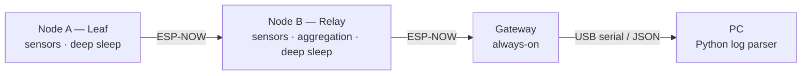

# Energy-Efficient Linear Multi-Hop IoT Network (ESP32-C6 / ESP-NOW)

<!-- DRAFT — not public yet. Items marked TODO must be resolved before switching the repo to public. -->

A battery-powered sensor chain for precision agriculture: leaf and relay nodes sleep most of the time, wake on a shared schedule, and forward readings hop-by-hop over ESP-NOW to an always-on gateway. Built as an individual research project (TED University, CMPE490 – Introduction to Research in Computer Engineering, Spring 2026).

**Status:** Working indoor prototype — research phase completed (June 2026). Not field-tested. *Last updated: 10.2026*

---

## Problem

Field sensors in agriculture are often out of Wi-Fi range and must run on batteries. A Wi-Fi/MQTT-per-node design keeps the radio on too long. This project explores how far a low-cost ESP32 chain can go using a connectionless protocol (ESP-NOW) plus coordinated sleep, without an external RTC or extra radio hardware.

## Architecture



<!-- TODO: confirm final hardware node count (paper p.6 says 3-node chain; pp.20/22/25 say two-node hardware). Diagram must match what was physically tested. -->

## Key features

| Feature | Approach |
|---|---|
| Time synchronization | Cristian's algorithm + EWMA smoothing (α = 0.2); no external RTC |
| Setup phase | Handshake to align nodes at first power-on |
| Adaptive TX power | RSSI-driven, 11.0–19.5 dBm, ±5 dB hysteresis |
| In-network aggregation | Relay merges its own and the leaf's readings into one packet |
| Self-healing | Failure counter persisted in RTC memory across deep sleep; skip-route after 3 failures |
| Sensor power gating | P-MOSFET switches analog sensors off during sleep |
| FEC | 5 bytes reserved in packet; Hamming(72,64) **not implemented** (future work) |

## Hardware

| Item | Detail |
|---|---|
| MCU | ESP32-C6 Super Mini (RISC-V, 160 MHz) — all nodes |
| Sensors (V2) | DS18B20 (temperature), BMP280 (pressure/temperature), SW-520D (tilt) |
| Sensors (V1) | DHT22, resistive soil moisture, battery voltage divider |
| Power | Single-cell lithium battery <!-- TODO: model / capacity --> |
| Gateway link | USB serial, 115200 baud, JSON lines |

<!-- TODO: wiring diagram / photo (docs/hardware/) -->

## Results

**Test setup:** indoor, ~1.5 m node spacing, 15 s sleep interval, ~30 min run, gateway serial logs parsed offline in Python. Single run unless noted.

### Measured

| Metric | Result | Target | Conditions |
|---|---|---|---|
| Packet delivery ratio | 99.6 % (273 / 274) | > 95 % | 1 × 30 min run, no repetitions |
| Clock sync accuracy | ±2.6 ms max deviation | ±5 ms | <!-- TODO: cycle count (paper gives 34 / 27 / ≥20) --> |
| TX power at minimum level | 97.4 % of cycles (266 / 273) at 11.0 dBm | — | 2 power changes during a fade event |
| TX current @ 11 dBm | ~125 mA | — | USB tester |

### Calculated / not measured

The following are **model-based estimates**, not measurements: per-cycle energy (~1.19 J relay), TPC energy saving (~2.6 % of active-phase energy), aggregation radio-time saving, setup convergence time, self-healing recovery time. Battery life and end-to-end latency were **not measured**.

## Engineering note: ADC vs. ESP-NOW init order

On ESP32-C6 (ESP-IDF v5.3.2), ADC readings became invalid when taken after `esp_now_init()`. Reading all ADC channels **before** initializing ESP-NOW resolved it. <!-- TODO: link to Espressif docs/issues check; keep wording as "observed" unless confirmed undocumented --> 

## Limitations

- Indoor tests only, short distances, one ~30 min run
- No current meter: battery drain and lifetime not measured
- Self-healing and setup timing verified in logic, not physically fault-injected
- One BMP280 unit gave invalid readings due to a weak I²C pull-up
- FEC reserved but not implemented

## Next steps

- Power profiling with a proper current meter (baseline vs. TPC/aggregation)
- Longer chains and outdoor tests
- Hamming(72,64) FEC

## Repository layout

<!-- TODO: fill after clean code import -->
```
components/ag_common/   shared packet definitions
node/                   leaf + relay firmware (same binary, NODE_ID selects role)
gateway/                gateway firmware (serial output)
tools/                  Python log parser
docs/                   paper, measurement data, hardware
```

## Build

Requires ESP-IDF v5.3.2.

```bash
cd gateway && idf.py set-target esp32c6 && idf.py build flash monitor
cd node    && idf.py set-target esp32c6 && idf.py build flash monitor   # set NODE_ID in node_config.h
```

<!-- TODO: power-on order + MAC table steps from old README (corrected for serial gateway) -->

## Paper

*Energy-Efficient Linear Multi-Hop IoT Network for Precision Agriculture* — S. B. Altay, supervised by Prof. Dr. Gökçe Nur Yılmaz, TED University, 2026.
<!-- TODO: link after v1.1 corrections + supervisor approval (arXiv or Zenodo) -->

---

### Türkçe özet

ESP32-C6 ve ESP-NOW üzerinde, pil ile çalışan doğrusal çok-atlamalı bir tarım sensör ağı. Düğümler ortak bir zaman çizelgesiyle uyanıyor; veriler aracı düğümde birleştirilip ağ geçidine iletiliyor. İç mekân testinde %99,6 paket iletim oranı ve ±2,6 ms saat senkronizasyonu ölçüldü. Enerji kazanımları hesaplanmış olup ölçülmemiştir.

## License

<!-- TODO: MIT for code; paper rights separately -->
